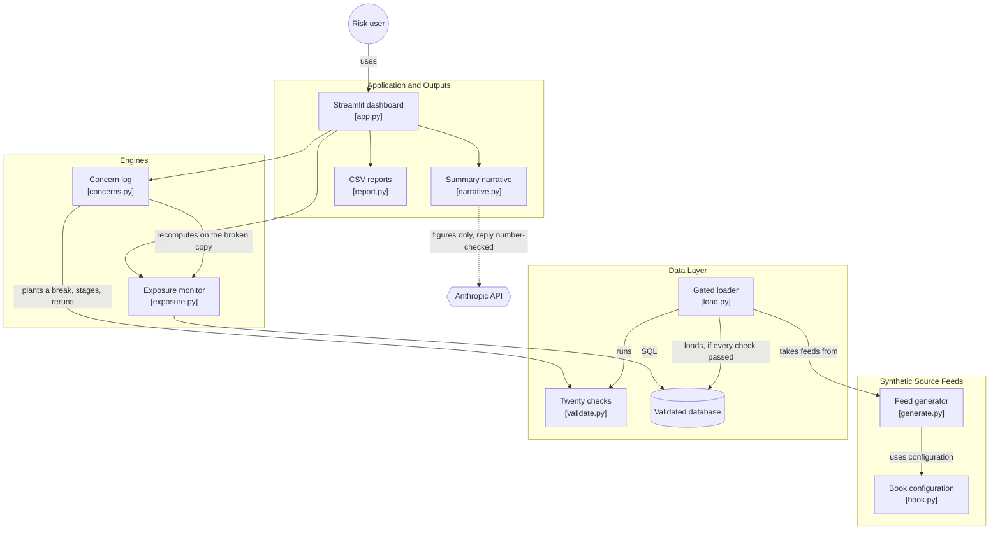

# counterparty-data-lab

[](https://github.com/nmadagi/counterparty-data-lab/actions/workflows/ci.yml)

I built this to show the data layer under a counterparty exposure
number. A securities lending desk marks every loan and every piece of
collateral at the close, rolls them up per borrower, and sends margin
calls and limit flags to credit. That report is only as good as the
trade capture feed, the price feed and the reference data under it. So
this is a synthetic lending book (twelve borrowers, four lent asset
classes, five collateral classes, three years of daily closes) with
three things on top: the controls that gate every load, a concern log
for what happens when a feed breaks, and the exposure report those two
protect.

All data is synthetic. No real institution, no real client, no real
price.

Live app: https://counterparty-data-lab.streamlit.app

## The finding

I planted three breaks in a copy of the feed, one at a time, and loaded
each copy through the same checks as the live load. Every break is
caught by name. Then I recomputed the exposure report on the broken
copy to see what the consumer would have met if it had got through.

| Concern | Break | Caught by | Impact if it had loaded |
|---|---|---|---|
| DC-001 | One position sent twice from trade capture | `position_id_unique` | Alder on loan overstated by $301M |
| DC-002 | A position keyed to a borrower not in reference data | `positions_reference_borrower` | Dogwood on loan understated by $267M, its limit breach hidden |
| DC-003 | The large cap lent price feed stopped updating | `price_feed_not_frozen` | Birch's $49M margin call not raised, 8 borrowers mismarked |

Two of the three understate risk, and those are the expensive ones: a
limit breach nobody sees, a margin call that does not go out. The
duplicate overstates it, which blocks good business instead. On the
report itself nothing looks wrong in any of the three cases. The
coverage ratio still reads about 103% and the table still has twelve
rows. That is the argument for checking the feed, not the headline.

## How it hangs together

Prices, borrowers (reference data) and position-level loans (the trade
capture feed) are generated with a fixed seed and loaded into DuckDB.
The load is gated by twenty checks in four families: record counts,
control totals per borrower, completeness (nulls, zero prices, every
series on every date, no series frozen on a repeated close) and
reference data (every position keys to a known borrower and class, no
position id twice). Any failed check blocks the load and names itself.
Everything downstream reads from that layer with SQL.

Three tabs. Data controls lists every check on this load with what it
found. Data concerns is the log: each break with the check that caught
it, the consumer it affects, the impact in dollars against the clean
report, severity (high when risk would have been understated), root
cause, the compensating action that protects the consumer today, the
permanent fix, and a due date ten business days out. Pick one and the
tab shows the affected borrower clean against broken. Counterparty
exposure is the morning report: every borrower marked at the close
against the house margin schedule, its exposure limit and its
non-standard collateral cap.

The one AI piece is the senior management summary. The engine computes,
the LLM only phrases: it gets a block of finished figures, and every
number in its reply is checked against that block before display. If it
invents one, the reply is discarded for a deterministic template. No API
key means the template runs alone.



## Run it

```
pip install -r requirements.txt
streamlit run app.py
```

Tests: `python -m pytest tests/`. Export the tables, the exposure report
and the concern log as CSV: `python -m data.export`.

Calibration and every simplification are written up in
[docs/assumptions.md](docs/assumptions.md). Build decisions are in
[notes.md](notes.md).

## Author

Nitin Madagi - [github.com/nmadagi](https://github.com/nmadagi)

MIT license.
